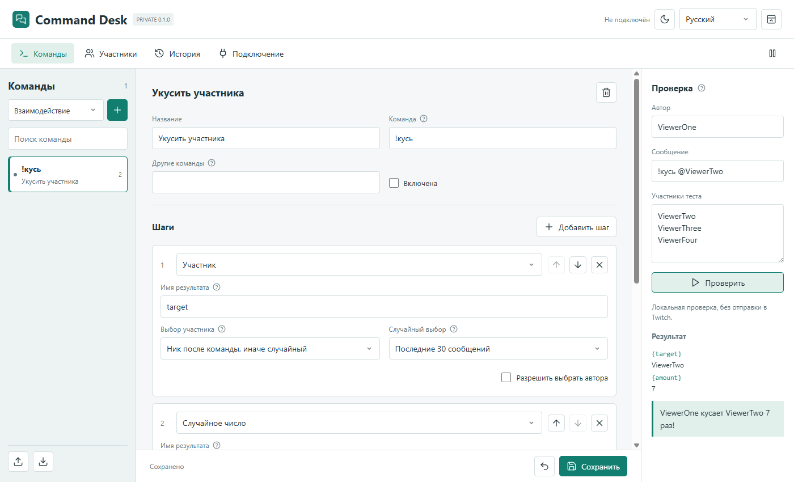
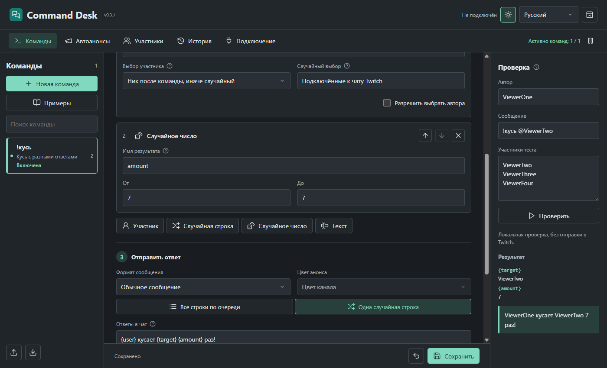
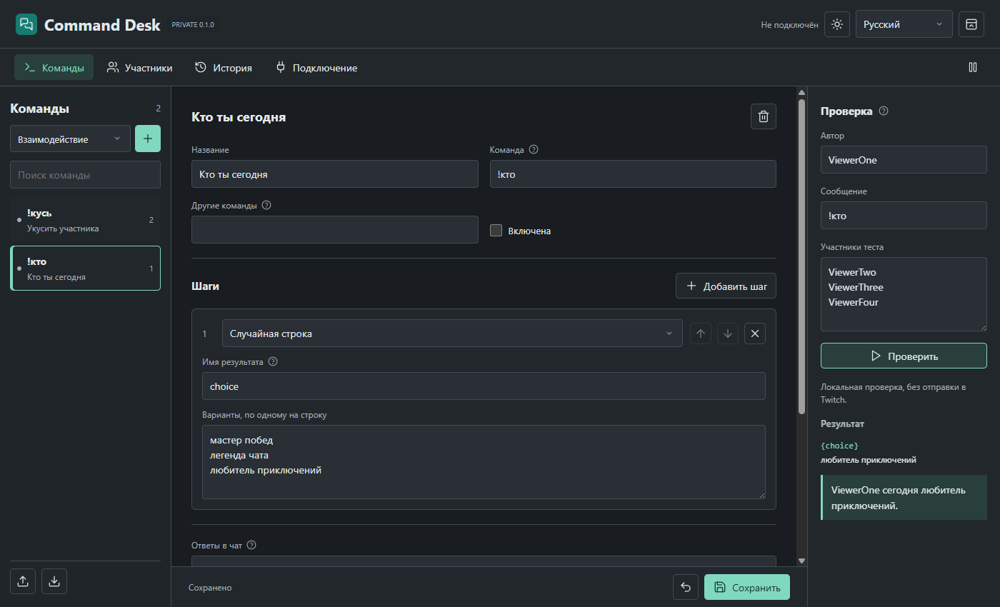
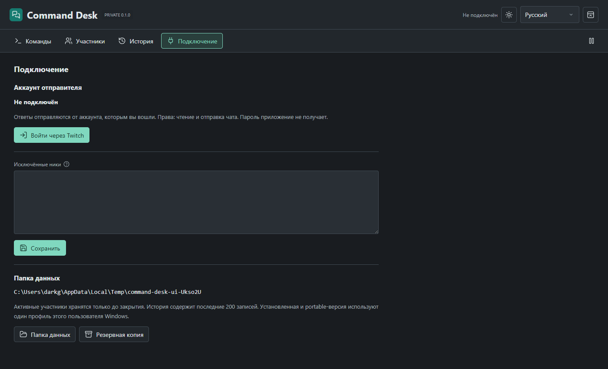

# Command Desk

[English](docs/README.en.md) · [Українська](docs/README.uk.md)

Приватная версия **0.1.0**. Локальный конструктор команд Twitch для Windows: ответы отправляются от аккаунта стримера. Streamer.bot, отдельный аккаунт-бот, внешний сервер и ручной ввод OAuth-токенов не нужны.



## Возможности

- Свои команды и альтернативные названия, включая кириллицу.
- До 12 редактируемых шагов: участник, случайная строка из списка, случайное целое число, промежуточный текст.
- Имена результатов шагов и порядок выполнения редактируются. Результат доступен последующим шагам.
- Полностью свой текст ответа: до трёх сообщений, переменные в любом месте. Никаких обязательных фраз или подписи приложения.
- `!кусь` выбирает случайного участника, `!кусь @ник` использует указанный ник. Команда, поведение и тексты не зашиты: это редактируемый начальный шаблон.
- `!кто` выбирает одну строку из вашего списка, после чего подставляет её в ваш ответ.
- Два пула: участники сообщений за последние 15 минут или участники последних 30 сообщений с начала текущего запуска.
- Каждый уникальный участник имеет равный шанс. Многократные сообщения не дают дополнительных шансов. Выбор через `crypto.randomInt`; повторный выбор разрешён.
- Известные боты, канал и исключённые ники не участвуют в случайном выборе; автора можно разрешить отдельной галочкой.
- Права доступа, общая и персональная задержка, общая пауза, защита от собственных ответов и повторов EventSub.
- Локальная проверка с выбранными автором, сообщением и тестовыми участниками, без отправки в Twitch.
- Сохранение черновика при редактировании, резервные копии перед изменением/удалением, импорт и экспорт команд.
- Светлая/тёмная темы; русский, украинский и английский интерфейс без перезапуска. Перевод интерфейса не меняет ваши тексты.




## Установка

Windows 10/11 x64. В приватном разделе [Releases](https://github.com/foolka/command-desk/releases):

- `command-desk-0.1.0-windows-x64-setup.exe`: установка в `%LOCALAPPDATA%\Programs\Command Desk`, ярлыки в меню «Пуск» и на рабочем столе.
- `command-desk-0.1.0-windows-x64-portable.zip`: распакуйте и запустите `CommandDesk.exe`, установка не нужна.

Обе сборки на одном аккаунте Windows используют **один** профиль `%APPDATA%\CommandDesk`. Portable относится к запуску без установки, а не к хранению базы рядом с EXE. Так запуск старого закреплённого ярлыка или перенос папки не создаёт незаметно другую базу. Два экземпляра одновременно не запускаются. Для переноса на другой ПК экспортируйте команды; вход Twitch выполняется заново.

Сборки пока без сертификата подписи кода. Windows может показать предупреждение о неизвестном издателе. Проверяйте источник и SHA-256, не отключайте защиту Windows.

1. Откройте «Подключение» → «Войти через Twitch».
2. Нажмите «Открыть Twitch», введите код и подтвердите права чтения/отправки чата.
3. Создайте команду, измените шаги и тексты. Новые команды по умолчанию выключены.
4. Проверьте результат в правой панели. Затем включите команду и сохраните.
5. Пока программа работает, она отвечает в вашем канале. Участники накапливаются только по новым сообщениям.

Крестик завершает приложение. Отдельная кнопка в шапке сворачивает в трей. Аргумент `--start-tray` запускает без показа окна, например из панели запуска стрима.



## Переменные

| Переменная | Значение |
| --- | --- |
| `{user}` | Отображаемое имя автора |
| `{login}` | Twitch-логин автора |
| `{channel}` | Канал |
| `{command}` | Введённая команда |
| `{args}` | Весь текст после команды |
| `{arg1}` | Первое слово после команды |
| `{target}`, `{choice}`, `{amount}` | Примеры имён, которые вы задаёте шагам |

Например: участник → `target`, список → `action`, число → `amount`, ответ:

```text
{user} {action} {target} {amount} раз!
```

Каждая строка поля «Ответы в чат» является отдельным сообщением. Лимит Twitch: 500 символов итогового сообщения. Неизвестная или ещё не вычисленная переменная блокирует сохранение. Шаблоны не исполняют JavaScript или другие программы. Для отсутствующей цели и неверного ника предусмотрены отдельные редактируемые ответы; пустая строка означает молчание.

Явно введённый ник проверяется по формату, но не на присутствие онлайн. Список участников не является списком всех смотрящих трансляцию. При перезапуске он очищается. В памяти хранится не больше 50 000 записей активности; для пула из 30 сообщений старые записи сохраняются до вытеснения новыми. Боты определяются по базовому списку и пользовательским исключениям, не безошибочно.

## Надёжность и приватность

- Прямое чтение EventSub и Send Chat Message API. Права только `user:read:chat`, `user:write:chat`; Client Secret отсутствует.
- Подключение повторяется при потере сети, токены обновляются и сохраняются через защищённое хранилище Windows.
- Полученные сообщения не сохраняются целиком: активность только в памяти, ID событий ограниченно в базе для защиты от дублей. История хранит последние 200 служебных записей и отправленных ответов, её можно очистить.
- Очередь ограничена 30 сообщениями, ответы старше 20 секунд пропускаются. Не больше 20 отправок за 30 секунд, с интервалом от 1,2 секунды.
- Команды из соседних каналов Shared Chat игнорируются. Ответы от аккаунта стримера Twitch показывает во всех каналах текущего Shared Chat: ограничить их исходным каналом с пользовательским токеном нельзя.
- Неопределённый результат отправки не повторяется автоматически: это защищает от дублей, но после сетевого сбоя ответ может быть пропущен.
- Резервные копии последних 20 состояний команд и настроек находятся в `backups`. OAuth туда не входит. Импорт добавляет команды, а при совпадении имён отклоняется целиком.
- При исчезновении, повреждении или перенаправлении существующей базы программа не подменяет её пустой.
- Удаление приложения сохраняет профиль. В установщике нет баз, авторизации или пользовательских команд.
- Нет аналитики и передачи профиля разработчику. При использовании Twitch сообщения и ответы передаются Twitch.

Будущий **Command Desk OBS** будет отдельным продуктом, отдельным репозиторием и профилем. Эта версия не содержит OBS-плагин и не требует OBS.

## Разработка

Node.js 24.14.x, Windows x64, Inno Setup 6.

```powershell
npm ci
npm run assets
npm test
npm run test:ui
npm start
npm run build
$env:ISCC_EXE = 'C:\Program Files (x86)\Inno Setup 6\ISCC.exe'
npm run installer
```

Тесты используют изолированные профили и подставной Twitch. Режим `--test-mode` требует `COMMAND_DESK_TEST_DATA`, рабочий профиль запрещён. Скриншоты снимаются с настоящего интерфейса на тестовых данных.

Для своего форка создайте отдельную Public OAuth Application и замените Client ID в `twitch-client.json`. Обычный пользователь этого не делает.

[Twitch: авторизация](https://dev.twitch.tv/docs/chat/authenticating/) · [Send Chat Message](https://dev.twitch.tv/docs/api/reference/#send-chat-message) · [EventSub](https://dev.twitch.tv/docs/eventsub/eventsub-subscription-types/#channelchatmessage)

GPL-2.0-or-later. Авторизация и часть инструментов сборки адаптированы из Alert Desk, © FermionaPlay. Исходники скопированы в этот самостоятельный репозиторий; зависимости от соседних проектов во время сборки или работы нет.
