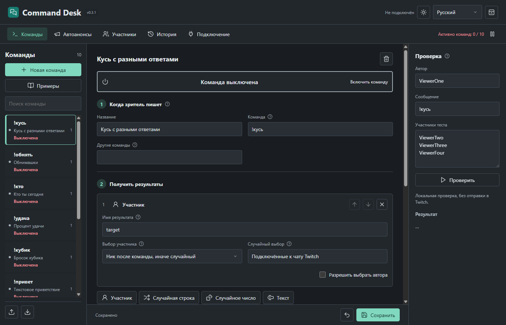
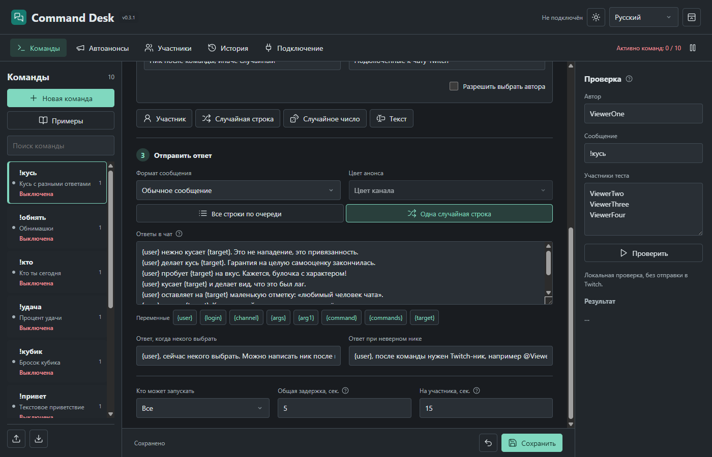
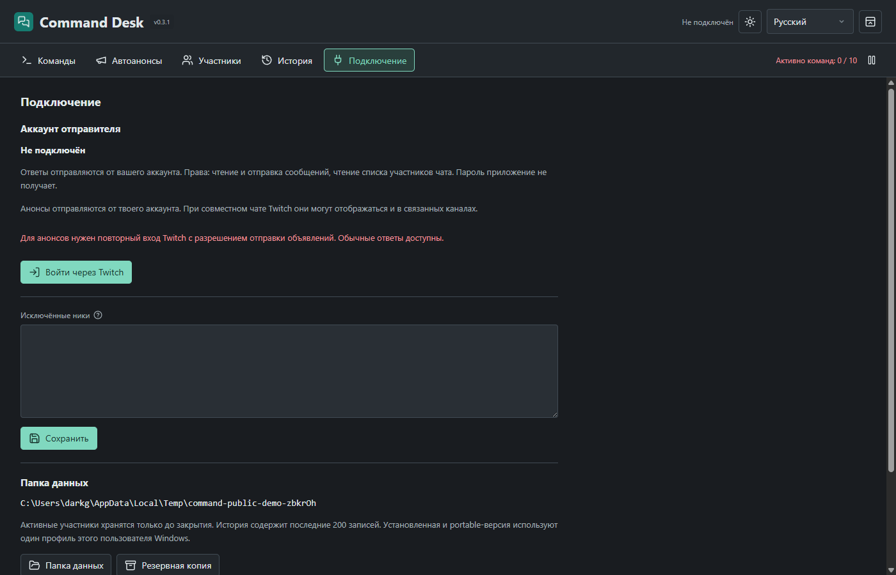
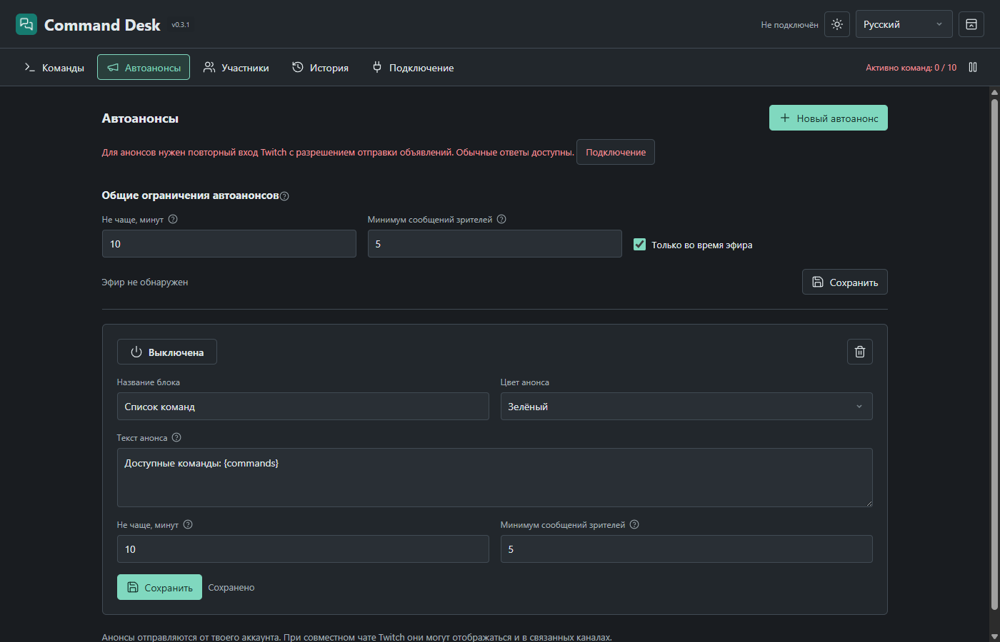

# Command Desk

[English](docs/README.en.md) · [Українська](docs/README.uk.md)

Публичная версия **0.3.1**. Локальный конструктор команд Twitch для Windows: ответы отправляются от аккаунта стримера. Streamer.bot, отдельный аккаунт-бот, внешний сервер и ручной ввод OAuth-токенов не нужны.

При первом запуске уже есть **10 готовых команд и автоанонс списка команд**. Все выключены: отредактируйте тексты и ссылки, затем включите нужные. Обновление не заменяет существующие команды и не возвращает удалённые примеры. Через [Launch Desk OBS](https://github.com/foolka/launch-desk-obs) 0.3.0+ приложение можно запускать вместе с OBS, обычным окном или в трей.



## Возможности

- Свои команды и альтернативные названия, включая кириллицу.
- До 12 редактируемых шагов: участник, случайная строка из списка, случайное целое число, промежуточный текст.
- Имена результатов шагов и порядок выполнения редактируются. Результат доступен последующим шагам.
- Крупный переключатель немедленного включения команды, понятный выбор шаблона и конструктор из трёх этапов.
- Полностью свой текст ответа: все строки по очереди (до трёх) или одна случайная из списка (до 100 вариантов). Переменные вставляются кнопками. Никаких обязательных фраз или подписи приложения.
- Десять готовых примеров: кусь с разными фразами, обнимашки, кто ты, процент удачи, кубик, приветствие, комбинация зрителя/числа/текста, Telegram, Discord и список команд. Добавляются выключенными, твои команды не заменяют.
- Информационные команды могут отправлять цветной анонс Twitch. `{commands}` выводит включённые команды, доступные автору запроса.
- Автоанонсы с редактируемыми текстом, цветом, интервалом и минимумом сообщений зрителей; общие ограничения защищают от нескольких анонсов подряд.
- `!кусь` выбирает случайного участника, `!кусь @ник` использует указанный ник. Команда, поведение и тексты не зашиты: это редактируемый начальный шаблон.
- `!кто` выбирает одну строку из вашего списка, после чего подставляет её в ваш ответ.
- Случайный участник из списка подключённых к чату Twitch, включая тех, кто молчит. Список обновляется примерно каждые 30 секунд, история сообщений больше не ограничивает выбор.
- Каждый уникальный участник имеет равный шанс. Многократные сообщения не дают дополнительных шансов. Выбор через `crypto.randomInt`; повторный выбор разрешён.
- Известные боты, канал и исключённые ники не участвуют в случайном выборе; автора можно разрешить отдельной галочкой.
- Права доступа, общая и персональная задержка, общая пауза, защита от собственных ответов и повторов EventSub.
- Локальная проверка с выбранными автором, сообщением и тестовыми участниками, без отправки в Twitch.
- Сохранение черновика при редактировании, резервные копии перед изменением/удалением, импорт и экспорт команд.
- Светлая/тёмная темы; русский, украинский и английский интерфейс без перезапуска. Перевод интерфейса не меняет ваши тексты.



## Установка

Windows 10/11 x64. В разделе [Releases](https://github.com/foolka/command-desk/releases):

- `command-desk-0.3.1-windows-x64-setup.exe`: установка в `%LOCALAPPDATA%\Programs\Command Desk`, ярлыки в меню «Пуск» и на рабочем столе.
- `command-desk-0.3.1-windows-x64-portable.zip`: распакуйте и запустите `CommandDesk.exe`, установка не нужна.

Обе сборки на одном аккаунте Windows используют **один** профиль `%APPDATA%\CommandDesk`. Portable относится к запуску без установки, а не к хранению базы рядом с EXE. Так запуск старого закреплённого ярлыка или перенос папки не создаёт незаметно другую базу. Два экземпляра одновременно не запускаются. Для переноса на другой ПК экспортируйте команды; вход Twitch выполняется заново.

Сборки пока без сертификата подписи кода. Windows может показать предупреждение о неизвестном издателе. Проверяйте источник и SHA-256, не отключайте защиту Windows.

1. Откройте «Подключение» → «Войти через Twitch».
2. Нажмите «Открыть Twitch», введите код и подтвердите права чтения/отправки чата и просмотра его участников.
3. Создайте команду, измените шаги и тексты. Новые команды по умолчанию выключены.
4. Проверьте результат в правой панели, сохраните правки и включите команду большим переключателем. Включение применяется сразу.
5. Пока программа работает, она отвечает в вашем канале. Во вкладке «Участники» видны доступные для выбора пользователи и состояние загрузки списка.

После обновления с 0.1.x один раз заново войдите через Twitch, чтобы разрешить просмотр участников (`moderator:read:chatters`). Команды и их тексты сохраняются: даже ранее сохранённые команды используют новый список без пересоздания. До подтверждения нового разрешения случайные цели недоступны, но явный ник и ответы из списков продолжают работать.

Крестик завершает приложение. Отдельная кнопка в шапке сворачивает в трей. Аргумент `--start-tray` запускает без показа окна, например из панели запуска стрима.



## Анонсы и автоанонсы

Для отправки анонсов один раз повторите вход Twitch и подтвердите `moderator:manage:announcements`. До этого обычные ответы работают, а попытка анонса записывается в историю с причиной. В шаблонах `!тг` и `!дс` замените текст-заготовку своими ссылками перед включением.

Во вкладке «Автоанонсы» создайте блок, задайте текст, цвет и ограничения, затем сохраните и включите. По умолчанию: общий интервал 10 минут, минимум 5 сообщений зрителей и только во время эфира. У каждого блока есть собственные дополнительные ограничения. Время **и** число сообщений должны выполниться одновременно; ноль сообщений отключает только это условие. Интервалы настраиваются от 1 минуты до суток.

После любого анонса приложения общий счётчик сообщений обнуляется; одинаковый текст не повторяется в течение общего интервала. Свои сообщения канала, известные боты, исключённые ники, повторы событий и соседние каналы не считаются. Блоки чередуются по времени последней отправки. После перезапуска ждём полный интервал, пропущенные отправки не догоняем. При потере связи или общей паузе отправки останавливаются; после неоднозначной сетевой ошибки автоматического повтора нет. В автоанонсе поддерживается `{commands}`: актуальный список включённых команд для всех зрителей. Если список пуст или итог длиннее 500 символов, такой автоанонс пропускается. Остальной текст отправляется буквально.



## Переменные ответа

| Переменная | Значение |
| --- | --- |
| `{user}` | Отображаемое имя автора |
| `{login}` | Twitch-логин автора |
| `{channel}` | Канал |
| `{command}` | Введённая команда |
| `{args}` | Весь текст после команды |
| `{arg1}` | Первое слово после команды |
| `{commands}` | Включённые команды, доступные автору |
| `{target}`, `{choice}`, `{amount}` | Примеры имён, которые вы задаёте шагам |

Например: участник → `target`, список → `action`, число → `amount`, ответ:

```text
{user} {action} {target} {amount} раз!
```

В режиме «Все строки по очереди» каждая строка отправляется отдельно; в случайном режиме выбирается одна строка. Лимит Twitch: 500 символов итогового сообщения. Неизвестная или ещё не вычисленная переменная блокирует сохранение. Шаблоны не исполняют JavaScript или другие программы. Для отсутствующей цели и неверного ника предусмотрены отдельные редактируемые ответы; пустая строка означает молчание.

Явно введённый ник проверяется по формату, но не на присутствие онлайн. [Get Chatters](https://dev.twitch.tv/docs/api/reference#get-chatters) возвращает пользователей, подключённых к чату, а не всех смотрящих трансляцию: Twitch обновляет этот список с задержкой. Приложение загружает все страницы перед заменой списка. При ошибке или устаревании списка на 90 секунд случайный выбор приостанавливается, причина видна в интерфейсе и истории; выбор из старых сообщений не подставляется. Список хранится только в памяти. Боты определяются по базовому списку и пользовательским исключениям, не безошибочно.

## Надёжность и приватность

- Прямые EventSub, Get Chatters, Send Chat Message и [Send Chat Announcement](https://dev.twitch.tv/docs/api/reference#send-chat-announcement). Права `user:read:chat`, `user:write:chat`, `moderator:read:chatters`, `moderator:manage:announcements`; Client Secret отсутствует.
- Подключение повторяется при потере сети, токены обновляются и сохраняются через защищённое хранилище Windows.
- Полученные сообщения не сохраняются целиком: список участников только в памяти, ID событий ограниченно в базе для защиты от дублей. История хранит последние 200 служебных записей и отправленных ответов, её можно очистить.
- Очередь ограничена 30 сообщениями, ответы старше 20 секунд пропускаются. Не больше 20 отправок за 30 секунд, с интервалом от 1,2 секунды.
- Команды из соседних каналов Shared Chat игнорируются. Ответы от аккаунта стримера Twitch показывает во всех каналах текущего Shared Chat: ограничить их исходным каналом с пользовательским токеном нельзя.
- Неопределённый результат отправки не повторяется автоматически: это защищает от дублей, но после сетевого сбоя ответ может быть пропущен.
- Резервные копии последних 20 состояний команд и настроек находятся в `backups`. OAuth туда не входит. Импорт добавляет команды, а при совпадении имён отклоняется целиком.
- При исчезновении, повреждении или перенаправлении существующей базы программа не подменяет её пустой.
- Удаление приложения сохраняет профиль. В установщике нет баз, авторизации или пользовательских команд.
- Нет аналитики и передачи профиля разработчику. При использовании Twitch сообщения и ответы передаются Twitch.

Будущий **Command Desk OBS** будет отдельным продуктом, отдельным репозиторием и профилем. Эта версия не содержит OBS-плагин и не требует OBS.

## Разработка

Node.js 24.14.x, Windows x64, Inno Setup 6.

```powershell
npm ci
npm run assets
npm test
npm run test:ui
npm start
npm run build
$env:ISCC_EXE = 'C:\Program Files (x86)\Inno Setup 6\ISCC.exe'
npm run installer
```

Тесты используют изолированные профили и подставной Twitch. Режим `--test-mode` требует `COMMAND_DESK_TEST_DATA`, рабочий профиль запрещён. Скриншоты снимаются с настоящего интерфейса на тестовых данных.

Для своего форка создайте отдельную Public OAuth Application и замените Client ID в `twitch-client.json`. Обычный пользователь этого не делает.

[Twitch: авторизация](https://dev.twitch.tv/docs/chat/authenticating/) · [Send Chat Message](https://dev.twitch.tv/docs/api/reference/#send-chat-message) · [EventSub](https://dev.twitch.tv/docs/eventsub/eventsub-subscription-types/#channelchatmessage)

GPL-2.0-or-later. Авторизация и часть инструментов сборки адаптированы из Alert Desk, © FermionaPlay. Исходники скопированы в этот самостоятельный репозиторий; зависимости от соседних проектов во время сборки или работы нет.

## Windows taskbar / Панель задач / Панель завдань

В настройках приложения есть кнопка «Закрепить на панели задач» и статус от Windows. Запрос выполняется только по нажатию и требует подтверждения Windows. Если штатный API недоступен, закрепи значок запущенного приложения через его контекстное меню. Снятие закрепления также выполняется в этом меню.

Обновляй установленную версию поверх прежней, в той же папке: имя EXE, идентификатор приложения и путь иконки сохраняются. Полное удаление или перенос в другую папку может потребовать повторного закрепления. Portable-папку после закрепления не перемещай. Если ярлык «Пуск» ведёт к другой копии, приложение предупредит и не заменит его молча.

У налаштуваннях є кнопка «Закріпити на панелі завдань» зі статусом Windows. Підтвердь системний запит; якщо API недоступний, скористайся контекстним меню значка. Оновлення в тій самій папці зберігає шлях. Після перенесення portable-папки чи повного видалення може знадобитися повторне закріплення.

Settings include **Pin to taskbar** with status read from Windows. Pinning requires an explicit click and Windows confirmation. Unsupported systems show manual instructions. Updates in the same installation folder retain the executable, AppUserModelID and icon path. Moving a portable folder or completely uninstalling may require pinning again. A shortcut targeting another copy is never silently overwritten.

Native build prerequisite: Windows x64, MSVC and Windows SDK, plus Node-API headers (for example `npx node-gyp install --target=20.17.0`). Set `NODE_API_HEADERS` to that cache directory if using a different location. `npm run build` compiles the repository's own `native/taskbar.cpp`; no runtime imports from other Desk projects. No LAF restriction is bypassed on older Windows.
