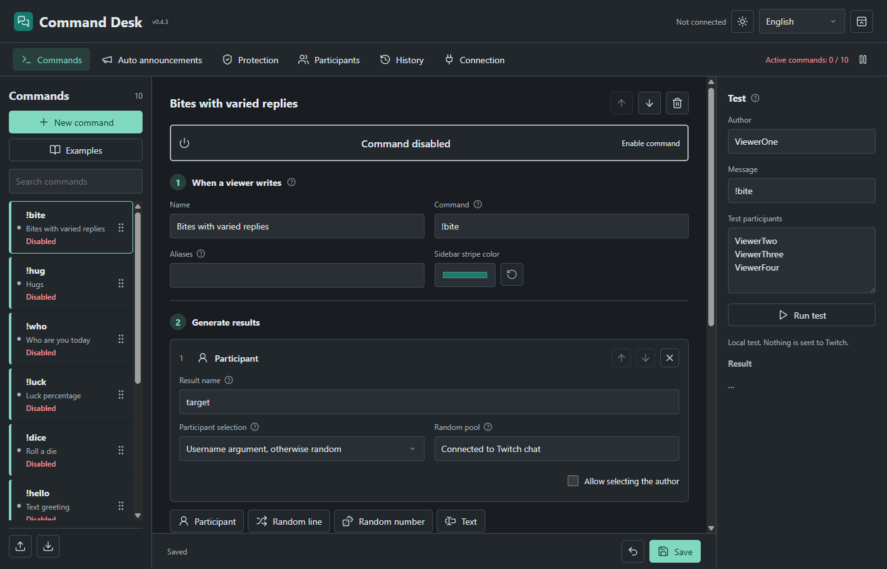
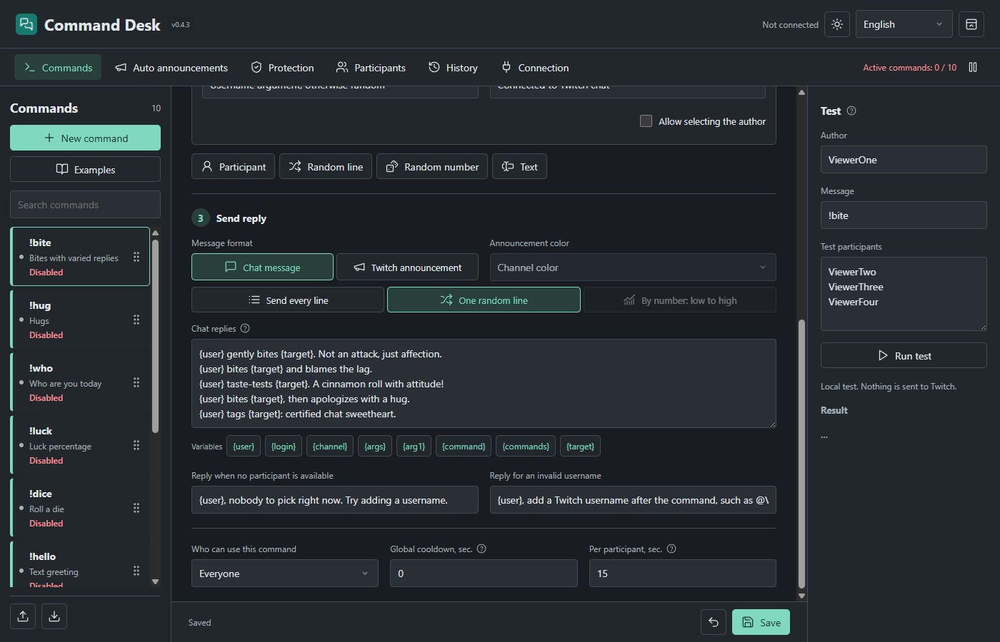
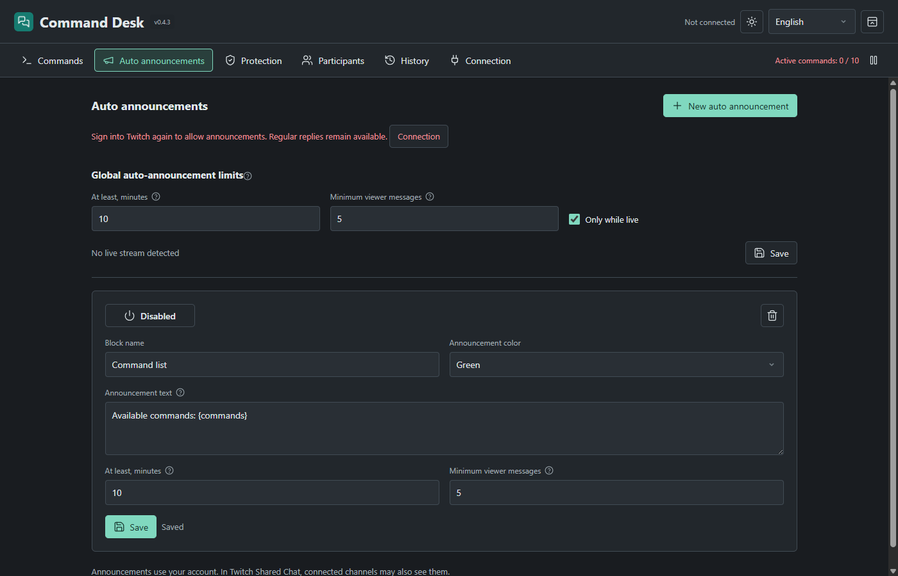

# Command Desk

[Русский](../README.md) · [Українська](README.uk.md)

Public release **0.4.3**. A local Windows Twitch command builder that replies as the broadcaster. No separate bot account, Streamer.bot or hosted backend is required.

Fresh profiles include **10 editable commands and a command-list auto announcement**, all disabled until you choose to enable them. Updates never overwrite existing commands or restore deleted examples. [Launch Desk OBS](https://github.com/foolka/launch-desk-obs) 0.3.0+ can start the app normally or in the tray with OBS. Timed messages support `{commands}` for currently enabled commands available to everyone; empty or over-500-character results are skipped.



## Features

- Direct Chat message / Twitch announcement buttons, a visible caret and reliable editor focus after tray restore. `{user}` and target steps produce @mentions for every participant; `{login}` stays raw for links.
- Reorder commands and assign always-visible color stripes. Independent incomplete drafts do not block switching commands and survive restarting without applying edits to live chat.
- Editable commands and aliases, including Cyrillic.
- Up to 12 ordered steps: participant selection, a random line, an integer, or intermediate text.
- A clear template picker, three-stage builder, immediate enable switch, clickable variables and viewport-safe tooltips.
- Editable replies: send all lines (up to three), or one random line from up to 100 variants. Ten disabled examples cover bites, hugs, roles, numbers, text, combined workflows and information announcements.
- Random participants from Twitch's connected chat users, including silent users. Refreshed approximately every 30 seconds, independent of message history. Every unique eligible person has the same chance.
- An explicit username argument can replace a random target. Online presence is not verified.
- Roles, cooldowns, pause, bot exclusions, replay and self-reply protection.
- A local simulator that never posts to Twitch, persistent drafts, backups, additive import/export.
- Russian, Ukrainian and English; light and dark themes. Switching language leaves user-authored content unchanged.



## Install

Download the EXE installer or portable ZIP from [Releases](https://github.com/foolka/command-desk/releases). Windows 10/11 x64.

The installer uses `%LOCALAPPDATA%\Programs\Command Desk`. Extract the portable ZIP and run `CommandDesk.exe` without installing. **Both builds use `%APPDATA%\CommandDesk` for the same Windows user**, not a database beside the executable. This avoids divergent profiles when folders or shortcuts change. Only one instance can run. To move to another computer, export your commands and sign in again.

Builds are currently unsigned. Check the release source and SHA-256; do not disable Windows security.

Open Connection → Sign in with Twitch → Open Twitch and authorize using the displayed code. Create a command, edit its steps, run a local test, then enable and save it. New commands start disabled. The window close button exits; the separate tray button hides it. `--start-tray` starts without showing the window.

After updating from 0.1.x, sign in with Twitch once more to grant `moderator:read:chatters`. Existing commands and text are preserved and use the new participant source without resaving. Until permission is granted, random targets are unavailable; explicit usernames and random text replies still work.

## Announcements

Sign in with Twitch again to grant `moderator:manage:announcements`. Ordinary commands keep working with existing permissions. Choose Twitch announcement as a command's output format; replace placeholder Telegram/Discord text with your actual links. `{commands}` lists enabled commands available to the caller.

Auto announcements have editable text, color, interval and minimum viewer messages. Both conditions must pass, together with global limits (defaults: 10 minutes, 5 messages, live streams only). Intervals range from 1 minute to 24 hours; zero messages disables that condition. Own messages, known bots, exclusions, shared-chat neighbours and duplicate events do not count. Every app announcement resets the global message gate. Identical texts are suppressed for the global interval. Blocks rotate fairly, restart waits a full interval, and ambiguous network failures are not retried. `{commands}` is replaced with enabled public commands; other text is literal. Shared Chat may distribute announcements to participating channels.



## Templates

Built-ins: `{user}`, `{login}`, `{channel}`, `{command}`, `{args}`, `{arg1}`. Each step defines another result, such as `{target}`, `{choice}` or `{amount}`. Results may be used by later steps and replies.

```text
{user} {action} {target} {amount} times!
```

All mode sends each reply line; Random mode sends one randomly selected line. Replies are limited to 500 final characters. Unknown or forward-referenced variables prevent saving. Templates do not execute code. Missing-target and invalid-username replies are editable; leave them empty to stay silent.

## Data and Limits

Twitch permissions: `user:read:chat`, `user:write:chat`, `moderator:read:chatters`, `moderator:manage:announcements`. Tokens are encrypted with Windows secure storage. There is no embedded client secret, analytics or developer upload.

The memory-only participant list comes from [Get Chatters](https://dev.twitch.tv/docs/api/reference#get-chatters), not chat messages. It includes connected chat users, not every video viewer, and Twitch reports joins/leaves with a delay. All pages must load before replacing the list. Failed requests or a snapshot older than 90 seconds suspend random targets and report the reason in the interface/history; there is no fallback to old messages. Known bots and configured exclusions are omitted, but bot detection is not infallible.

History retains 200 diagnostic/reply records and can be cleared. Bounded message IDs prevent reprocessing. The queue holds 120 messages for up to 5 minutes, with at most 20 sends per 30 seconds, 1.2-second spacing and 2.1-second announcement spacing. Pending replies survive socket reconnects and precede waiting timers; pausing or signing out clears them. Ambiguous network failures are never automatically resent. Shared-chat messages from other channels are ignored.

## Protection and ordered replies

Protection settings control the repeat threshold, counting window and both command-block durations. Defaults: the third consecutive use of the same command by one viewer within 60 seconds warns without executing; the next matching attempt blocks all their commands for 90 seconds. Further violations in this stream block for 10 minutes. Twitch chat is never timed out. Aliases count together; other viewers do not affect the sequence. Switching commands breaks a sequence before blocking. Penalties survive restart and reconnect, and reset on a confirmed new stream.

Shared cooldowns are off by default so different viewers can invoke commands together. Stored values remain available via Protection; personal command cooldowns still apply. Duplicate-text suppression applies only to automatic announcements, never to an explicitly requested command such as `!commands`.

Lists and replies support number-based selection. Order lines from bad to good and choose a number step. With 0–100 and five lines, the ranges are 0–20, 21–40, 41–60, 61–80 and 81–100. The maximum picks the last line; a constant range picks the first. Existing lists after an `amount` number step use this mode without changing any text. Independent random selection remains available.

Drag commands in the sidebar or use the editor arrow buttons. Each command has an optional full-height stripe color independent of Twitch announcement color. Order, color, command IDs and enabled states survive updates and restart.

When Shared Chat is active, Twitch distributes replies from the streamer's account to all participating channels. User-token replies cannot be restricted to the source channel.

Twenty command/settings snapshots are retained in `backups`; credentials are excluded. Imports are additive and fully rejected on naming conflicts. An existing missing/corrupt/redirected database is never silently replaced. Uninstalling keeps the profile.

The future OBS plugin is a separate product with its own repository and profile, not part of this release.

## Build

Node.js 24.14.x, Windows x64, Inno Setup 6. Run `npm ci`, `npm run assets`, `npm test`, `npm run test:ui`, `npm run build`, then set `ISCC_EXE` and run `npm run installer`. Tests use isolated profiles and mock Twitch. Forks must register their own Public Twitch application and replace `twitch-client.json`; end users do not need developer registrations.

GPL-2.0-or-later. Authentication and some packaging tools adapted from Alert Desk, © FermionaPlay. This repository has no runtime or build dependency on sibling projects.
