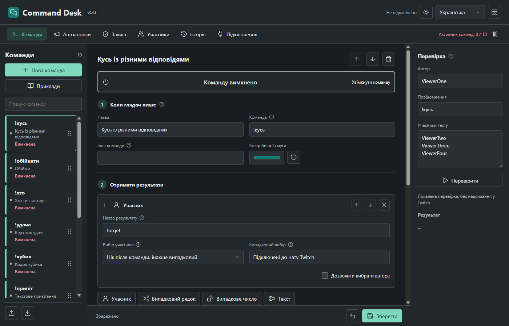
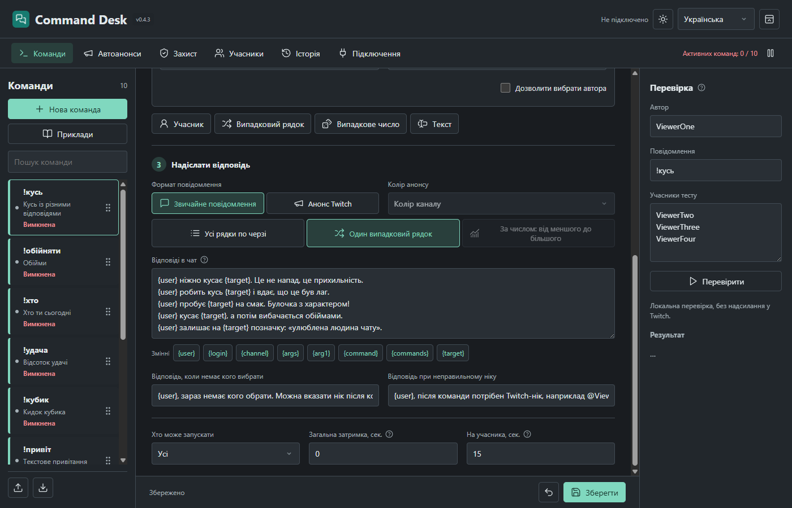
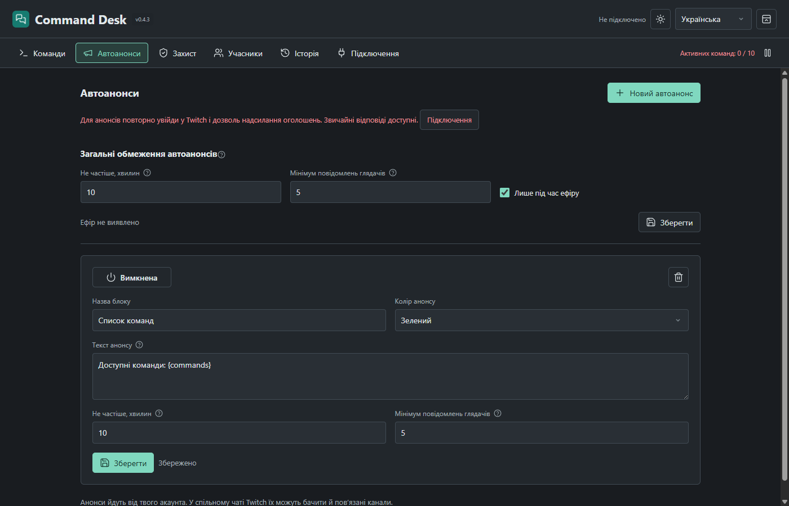

# Command Desk

[Русский](../README.md) · [English](README.en.md)

Публічна версія **0.4.3**. Локальний конструктор команд Twitch для Windows. Відповідає від акаунта стримера, без додаткового бота, Streamer.bot або зовнішнього сервера.

Новий профіль містить **10 готових команд і автоанонс списку команд**, усі спочатку вимкнені. Оновлення не замінює наявні команди й не повертає видалені приклади. [Launch Desk OBS](https://github.com/foolka/launch-desk-obs) 0.3.0+ запускає програму разом з OBS звичайним вікном або в трей. В автоанонсах `{commands}` означає ввімкнені команди для всіх глядачів; порожній результат або текст понад 500 символів пропускається.



## Можливості

- Формат відповіді обирається кнопками «Звичайне повідомлення / Анонс Twitch». `{user}` і цільові кроки додають @згадку кожного учасника; `{login}` лишається без @ для посилань.
- Команди можна переміщати й виділяти постійно видимою кольоровою смугою. Незавершені чернетки зберігаються окремо для кожної команди, не блокують перемикання й переживають перезапуск без застосування змін до чату.
- Команди та альтернативні назви з підтримкою кирилиці.
- До 12 кроків: учасник, випадковий рядок зі списку, ціле число, проміжний текст.
- Зрозумілий вибір шаблону, конструктор із трьох етапів, великий перемикач увімкнення, кнопки змінних і підказки без обрізання.
- Власні результати й тексти: усі рядки (до трьох) або один випадковий зі списку до 100 варіантів. Десять вимкнених прикладів: кусь, обійми, ролі, числа, привітання, комбінації та інформаційні анонси.
- Випадковий учасник зі списку підключених до чату Twitch, включно з тими, хто мовчить. Оновлення приблизно кожні 30 секунд, незалежно від історії повідомлень. Кожна унікальна людина має однаковий шанс.
- Нік після команди може замінити випадкову ціль. Присутність онлайн не перевіряється.
- Права доступу, затримки, пауза, виключення ботів, захист від повторів та власних відповідей.
- Локальна перевірка без надсилання у Twitch, збереження чернеток, резервні копії, імпорт та експорт.
- Українська, російська та англійська; світла та темна теми. Зміна мови не перекладає ваші власні тексти.



## Встановлення

EXE-інсталятор або portable ZIP доступні у публічному розділі [Releases](https://github.com/foolka/command-desk/releases). Windows 10/11 x64.

Інсталятор використовує `%LOCALAPPDATA%\Programs\Command Desk`. Portable ZIP можна розпакувати та запустити через `CommandDesk.exe` без встановлення. **Обидві версії використовують один профіль `%APPDATA%\CommandDesk` цього користувача Windows**, а не базу поруч із EXE. Перенесення папки або старий ярлик не створять іншу базу. Одночасно працює один екземпляр. Для іншого ПК експортуйте команди та увійдіть у Twitch знову.

Збірки поки не мають цифрового підпису видавця. Перевіряйте джерело та SHA-256; не вимикайте захист Windows.

Відкрийте «Підключення» → «Увійти через Twitch» → «Відкрити Twitch» та підтвердьте показаний код. Створіть команду, відредагуйте кроки, перевірте локально, увімкніть та збережіть. Нові команди спочатку вимкнені. Хрестик закриває застосунок, окрема кнопка згортає у трей. `--start-tray` запускає без показу вікна.

Після оновлення з 0.1.x ще раз увійдіть через Twitch, щоб надати `moderator:read:chatters`. Команди та тексти збережено: наявні команди використовують новий список без повторного збереження. До надання дозволу випадкові цілі недоступні, але вказаний нік і відповіді зі списків працюють.

## Анонси

Повторно увійдіть через Twitch і надайте `moderator:manage:announcements`. Звичайні команди продовжать працювати зі старими правами. Оберіть анонс Twitch як формат відповіді; у Telegram/Discord замініть заготовки своїми посиланнями. `{commands}` показує ввімкнені команди, доступні автору запиту.

Автоанонси мають текст, колір, інтервал і мінімум повідомлень. Обидві умови виконуються разом із загальними обмеженнями (типово: 10 хвилин, 5 повідомлень, лише ефір). Інтервали від 1 хвилини до доби; нуль повідомлень вимикає цю умову. Власні повідомлення, відомі боти, виключення, сусідні канали та дублікати подій не враховуються. Кожен наш анонс скидає загальний лічильник, однаковий текст не повторюється протягом загального інтервалу. Блоки чергуються; після перезапуску чекаємо повний інтервал без наздоганяння. Неоднозначні мережеві помилки не повторюємо. `{commands}` підставляє ввімкнені загальнодоступні команди; решта тексту надсилається буквально. Спільний чат Twitch може показати анонс і пов’язаним каналам.



## Шаблони

Вбудовані змінні: `{user}`, `{login}`, `{channel}`, `{command}`, `{args}`, `{arg1}`. Кожен крок додає власний результат, наприклад `{target}`, `{choice}`, `{amount}`. Його можна використовувати в наступних кроках та відповідях.

```text
{user} {action} {target} {amount} разів!
```

Режим «Усі» надсилає кожен рядок; випадковий режим обирає один. До 500 символів після підстановки. Невідомі змінні та посилання на ще не виконані кроки блокують збереження. Шаблони не виконують код. Відповіді для відсутньої цілі та неправильного ніка редагуються; порожнє поле означає мовчання.

## Дані та обмеження

Права Twitch: `user:read:chat`, `user:write:chat`, `moderator:read:chatters`, `moderator:manage:announcements`. Авторизація зашифрована сховищем Windows. Client Secret, аналітики та надсилання профілю розробнику немає.

Список у пам’яті надходить через [Get Chatters](https://dev.twitch.tv/docs/api/reference#get-chatters), а не з повідомлень. Це підключені до чату користувачі, а не всі глядачі відео; Twitch оновлює їх із затримкою. Заміна списку відбувається лише після завантаження всіх сторінок. Помилка запиту або список старіший за 90 секунд призупиняє випадковий вибір із поясненням в інтерфейсі та історії, без повернення до старих повідомлень. Відомі боти та налаштовані винятки виключаються, але визначення ботів не безпомилкове.

Історія містить 200 службових записів та відповідей і може очищатися. Кількість ID для захисту від повторів обмежена. Черга: до 120 повідомлень на 5 хвилин, не більше 20 надсилань за 30 секунд, інтервал від 1,2 секунди та 2,1 секунди між анонсами. Відповіді чекають відновлення сокета та мають пріоритет перед таймерами; пауза або вихід з акаунта очищує чергу. Невизначений результат надсилання не повторюється автоматично. Сусідні канали Shared Chat ігноруються.

## Захист і відповіді за числом

У «Захисті» налаштовуються кількість повторів, вікно підрахунку та тривалість обох блокувань. Типово третя однакова команда одного глядача за 60 секунд викликає попередження без виконання; наступна така спроба блокує всі його команди на 90 секунд. Подальше порушення за цей ефір блокує на 10 хвилин. Чат Twitch не блокується. Псевдоніми рахуються разом; чужі повідомлення не впливають. Інша команда перериває серію до блокування. Покарання зберігаються після перезапуску й перепідключення та скидаються для підтвердженого нового ефіру.

Загальна перезарядка типово не застосовується, тому різні глядачі не блокують одне одного. Збережені значення можна ввімкнути в «Захисті»; особисті перезарядки залишаються. Однаковий текст блокується лише для автоанонсів, а не для явного виклику на кшталт `!команди`.

Списки й відповіді підтримують вибір за числовим кроком. Розташуй рядки від поганого до хорошого. Для 0–100 та п’яти рядків діапазони: 0–20, 21–40, 41–60, 61–80, 81–100. Максимум обирає останній рядок; сталий діапазон обирає перший. Наявні списки після числового кроку `amount` використовують цей режим без заміни текстів. Незалежний випадковий вибір також доступний.

Перетягуй команди у бічному списку або користуйся стрілками редактора. Колір бічної смуги на всю висоту незалежний від кольору анонсу Twitch. Порядок, кольори, ID та ввімкнені стани зберігаються.

Коли Shared Chat активний, Twitch показує відповіді від акаунта стримера в усіх його каналах. Обмежити відповіді початковим каналом із користувацьким токеном неможливо.

У `backups` зберігаються 20 станів команд та налаштувань без авторизації. Імпорт додає команди та повністю відхиляється при конфліктах назв. Відсутня, пошкоджена або перенаправлена наявна база не замінюється порожньою. Видалення програми зберігає профіль.

Майбутній OBS-плагін матиме окремий репозиторій та профіль. Він не входить до цього випуску.

## Розробка

Node.js 24.14.x, Windows x64, Inno Setup 6. Команди: `npm ci`, `npm run assets`, `npm test`, `npm run test:ui`, `npm run build`; потім налаштуйте `ISCC_EXE` та виконайте `npm run installer`. Тести ізольовані, Twitch підставний. Для форка потрібна власна Public-реєстрація Twitch та заміна `twitch-client.json`; звичайні користувачі цього не роблять.

GPL-2.0-or-later. Авторизація та частина інструментів збірки адаптовані з Alert Desk, © FermionaPlay. Залежності від сусідніх проєктів під час збірки чи роботи немає.
